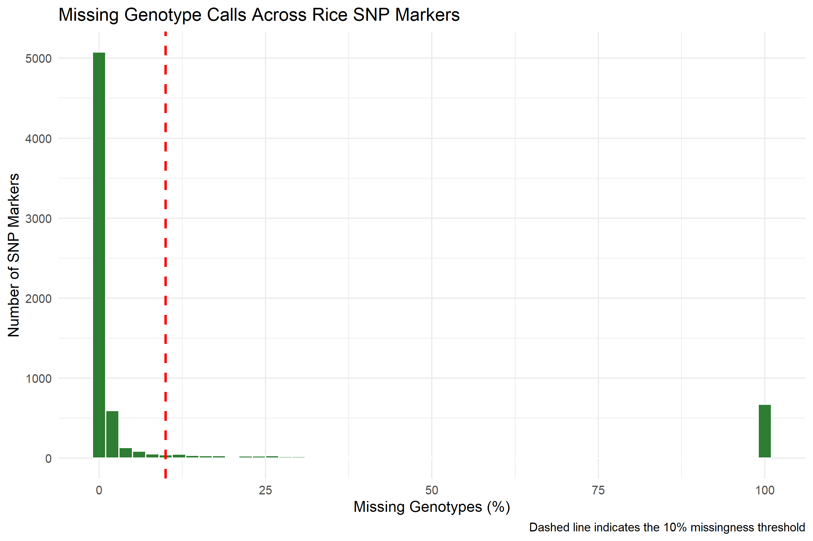
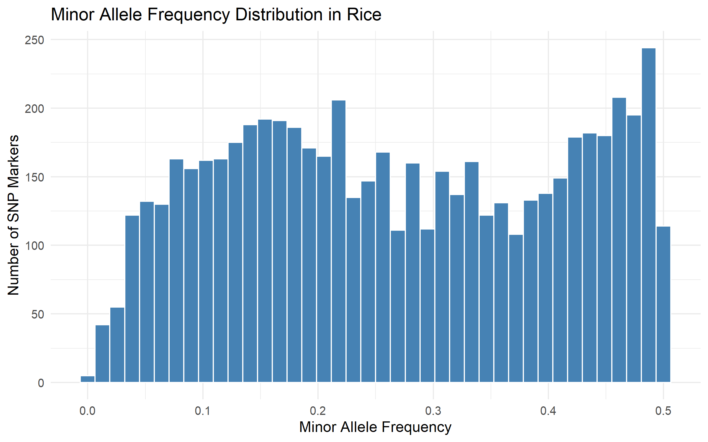
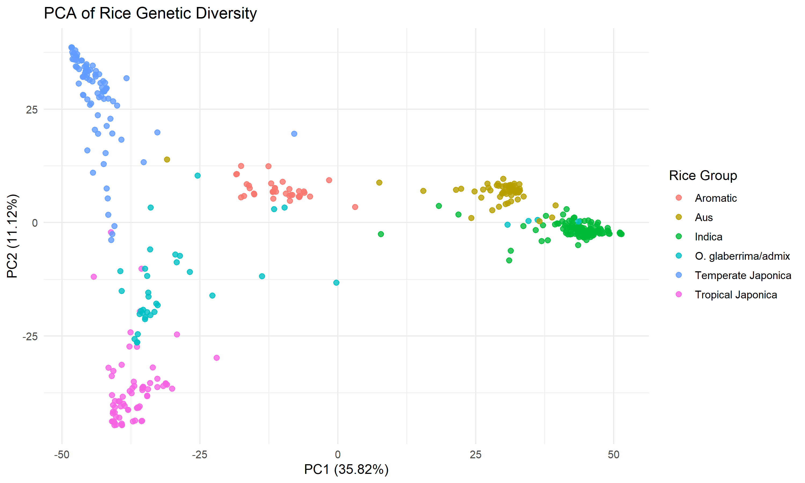
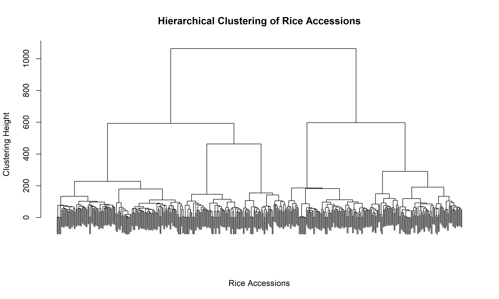
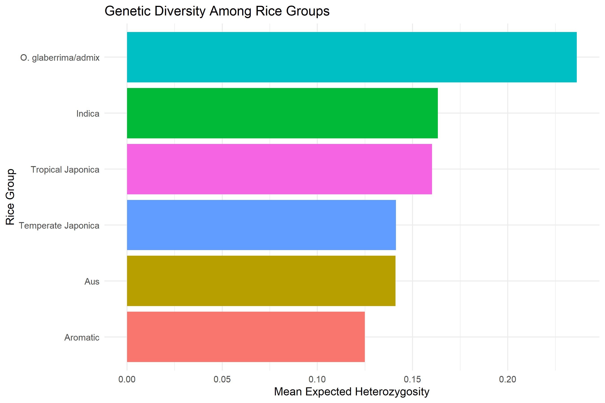

# Comparative Analysis of Genetic Diversity Among Rice (*Oryza sativa*) Varieties Using SNP Markers in R

## 1. Introduction

Rice (*Oryza sativa*) is an important food crop cultivated worldwide. Understanding genetic diversity among rice varieties is essential for crop improvement, conservation of genetic resources, and the identification of genetically distinct populations.

Single Nucleotide Polymorphisms (SNPs) are widely used molecular markers for studying genetic variation. SNP-based analyses can reveal population structure, genetic similarities, and differences among rice accessions.

This project investigates genetic diversity among rice accessions using SNP genotype data and the R programming language. The analysis includes genotype quality control, minor allele frequency (MAF) analysis, Principal Component Analysis (PCA), hierarchical clustering, and expected heterozygosity estimation.

## 2. Research Objectives

The objectives of this study are:

1. To preprocess and perform quality control on rice SNP genotype data.
2. To identify polymorphic SNP markers using minor allele frequency analysis.
3. To investigate genetic population structure using Principal Component Analysis.
4. To group genetically similar rice accessions using hierarchical clustering.
5. To compare genetic diversity among rice groups using expected heterozygosity.

## 3. Dataset Overview

The analysis uses SNP genotype and accession metadata from the Rice Diversity Project C7AIR 7K SNP dataset.

The original genotype matrix contained 7,098 SNP markers and 544 rice accessions. Accession metadata were used to identify samples annotated as *Oryza sativa*.

After matching accession identifiers and applying quality-control filtering, 449 rice accessions and 5,972 SNP markers were retained. Minor allele frequency analysis identified 5,970 polymorphic SNP markers for downstream analyses.

The retained accessions were classified into six annotated groups: Aromatic, Aus, Indica, O. glaberrima/admix, Temperate Japonica, and Tropical Japonica.

The `O. glaberrima/admix` category is retained from the original dataset's group annotation and does not imply that these selected samples were classified as the species *O. glaberrima*.

## 4. Methodology

This study followed a quantitative bioinformatics approach to investigate genetic diversity among rice (*Oryza sativa*) accessions using Single Nucleotide Polymorphism (SNP) markers. All data processing, statistical analyses, and visualisations were performed using the R programming language.

### 4.1 Data Import and Sample Selection

The Rice Diversity Project C7AIR 7K SNP dataset was imported into R using the `readxl` package. Two Excel files were used: an accession metadata table containing species and population group information, and a SNP genotype matrix containing molecular marker data.

The original dataset included 544 accessions and 7,098 SNP markers. Accessions annotated as *O. sativa* were selected, and sample identifiers were matched between the metadata and genotype matrix.

After identifier matching, 460 *O. sativa* accessions were available for quality-control analysis. Unmatched sample identifiers were excluded rather than being assigned to potentially incorrect accessions.

### 4.2 SNP Quality Control

Quality-control filtering was performed to reduce the influence of missing genotype data.

Two filtering criteria were applied:

- **Sample missingness threshold:** Accessions with more than 15% missing genotype calls were excluded.
- **SNP missingness threshold:** SNP markers with more than 10% missing genotype calls among the retained accessions were excluded.

After filtering, 449 accessions and 5,972 SNP markers remained. The filtered genotype matrix contained 10,288 missing genotype calls, which were retained as missing values during subsequent allele-frequency calculations.

### 4.3 Numerical Genotype Encoding

SNP genotypes were converted into numerical allele dosages to support statistical analysis.

For each biallelic SNP, the genotypes were encoded as:

- `0`: Homozygous for the first listed allele.
- `1`: Heterozygous genotype.
- `2`: Homozygous for the second listed allele.
- `NA`: Missing genotype call.

The encoding procedure used the allele definitions supplied in the SNP dataset. Complementary-strand genotype representations were also recognised when matching observed genotype calls to the reported allele pair.

This procedure produced a numerical matrix containing 5,972 SNP markers and 449 rice accessions.

### 4.4 Minor Allele Frequency Analysis

Minor Allele Frequency (MAF) was calculated for each SNP to measure the frequency of the less common allele.

The allele frequency was estimated from observed numerical genotype dosages, excluding missing calls. MAF was then calculated as:

\[
MAF = \min(p, 1-p)
\]

where \(p\) represents the frequency of one allele.

SNP markers with MAF equal to zero were classified as monomorphic. Of the 5,972 quality-controlled SNPs, two were monomorphic and 5,970 were polymorphic.

The 5,970 polymorphic SNPs were retained for downstream analyses.

### 4.5 Principal Component Analysis

Principal Component Analysis (PCA) was performed to investigate genetic relationships and population structure among rice accessions.

The numerical genotype matrix was transposed so that accessions represented observations and SNP markers represented variables. Missing genotype values were replaced using the mean dosage of the corresponding SNP.

PCA was performed using the R function `prcomp()`, with mean centering and without variance scaling.

The first two principal components were visualised using a scatter plot generated with `ggplot2`. Accessions were coloured according to their original rice group annotations.

### 4.6 Hierarchical Clustering

Hierarchical clustering was performed to identify genetically similar groups of rice accessions.

Euclidean distances were calculated using the mean-imputed numerical SNP genotype matrix. Agglomerative hierarchical clustering was then performed using Ward's method (`ward.D2`).

The resulting relationships were visualised using a dendrogram. The hierarchical tree was divided into six exploratory clusters to compare the genetic groupings with the six original dataset annotations.

Cluster purity and group-wise dominant-cluster percentages were calculated to assess agreement between the SNP-based clusters and the supplied rice group labels.

### 4.7 Genetic Diversity Estimation

Expected heterozygosity (He) was calculated to compare genetic diversity among the six annotated rice groups.

For each SNP within each group, expected heterozygosity was estimated using:

\[
H_e = 2p(1-p)
\]

where \(p\) represents the estimated frequency of one allele.

The mean expected heterozygosity across the analysed SNP markers was calculated separately for each group. Missing genotype calls were excluded from allele-frequency estimation.

The resulting diversity estimates were compared using a horizontal bar chart.

### 4.8 Data Visualisation and Reproducibility

The analysis generated figures illustrating SNP missingness, MAF distribution, population structure, hierarchical clustering, and genetic diversity.

R scripts were organised sequentially in the `code/` directory. Input and processed datasets were stored in `data/`, numerical outputs in `results/`, and visualisations in `figures/`.


## 5. Results

### 5.1 SNP Quality Control

The original SNP genotype dataset contained 7,098 SNP markers across 544 rice accessions. After selecting *Oryza sativa* samples and matching accession identifiers, 460 accessions were available for analysis.

Quality-control filtering using a maximum sample missingness of 15% and SNP missingness of 10% retained 449 accessions and 5,972 SNP markers. The resulting dataset contained 10,288 missing genotype calls, representing approximately 0.38% of the filtered genotype matrix.

These filtering procedures reduced missing data while retaining a substantial number of accessions and markers for genetic diversity analysis.



*Figure 1. Distribution of SNP missingness used to examine genotype data quality before downstream analysis.*

### 5.2 Minor Allele Frequency Analysis

Minor allele frequency analysis identified 5,970 polymorphic SNP markers and two monomorphic SNP markers among the 5,972 quality-controlled SNPs.

The monomorphic markers were excluded from subsequent population structure analyses because they contained no observed allelic variation across the retained accessions.



*Figure 2. Distribution of minor allele frequencies among quality-controlled SNP markers.*

### 5.3 Principal Component Analysis

Principal Component Analysis revealed genetic differentiation among the six annotated rice groups.

The first principal component (PC1) explained 35.82% of the total SNP variation, while the second principal component (PC2) explained 11.12%. Together, the first two components accounted for 46.94% of the variation.

The PCA scatter plot showed relatively distinct distributions for several rice groups. Indica accessions clustered primarily on the positive side of PC1, while Temperate Japonica and Tropical Japonica appeared mainly on the negative side. Aus and Aromatic accessions also formed recognisable groupings, although some overlap and outliers were observed.

The accessions annotated as O. glaberrima/admix showed a comparatively dispersed distribution, indicating greater heterogeneity in their positions on the first two principal components.



*Figure 3. Principal Component Analysis of 449 rice accessions using 5,970 polymorphic SNP markers. Colours represent the six original rice group annotations.*

### 5.4 Hierarchical Clustering

Hierarchical clustering based on Euclidean distances and Ward's method identified genetic relationships among the 449 rice accessions.

The dendrogram displayed several major branches, suggesting differentiation among groups of accessions with distinct SNP profiles.



*Figure 4. Hierarchical clustering dendrogram showing SNP-based relationships among 449 rice accessions.*

The dendrogram was divided into six exploratory clusters. Comparison with the original group annotations showed strong agreement, with an overall cluster purity of 95.10%.

The group-wise dominant-cluster percentages were:

| Rice Group | Dominant-Cluster Percentage |
|---|---:|
| Aromatic | 100.00% |
| Aus | 90.28% |
| Indica | 97.78% |
| O. glaberrima/admix | 81.08% |
| Temperate Japonica | 98.91% |
| Tropical Japonica | 94.59% |

Aromatic showed the highest group consistency, with all 39 accessions assigned to the same cluster. The O. glaberrima/admix annotated group showed the lowest consistency, with 81.08% of its accessions assigned to its dominant cluster.

These findings indicate substantial agreement between SNP-based clusters and the supplied annotations. However, cluster purity is a descriptive agreement measure, not independently validated classification accuracy.

### 5.5 Genetic Diversity Comparison

Mean expected heterozygosity was calculated across 5,970 polymorphic SNP markers for each annotated group.

| Rice Group | Accessions | Mean Expected Heterozygosity |
|---|---:|---:|
| O. glaberrima/admix | 37 | 0.2362 |
| Indica | 135 | 0.1632 |
| Tropical Japonica | 74 | 0.1602 |
| Temperate Japonica | 92 | 0.1412 |
| Aus | 72 | 0.1410 |
| Aromatic | 39 | 0.1249 |

The O. glaberrima/admix annotation had the highest mean diversity estimate, whereas Aromatic had the lowest. These are descriptive estimates for the selected SNP panel.



*Figure 5. Mean expected heterozygosity across the six annotated rice groups.*

## 6. Discussion

PCA and hierarchical clustering both revealed genetic structure broadly consistent with the six supplied group annotations.

### 6.1 Genetic Population Structure

PC1 and PC2 together explained 46.94% of SNP variation.

The PCA plot showed that Indica accessions were predominantly separated from Japonica accessions along PC1. Temperate Japonica and Tropical Japonica also formed distinguishable distributions, particularly along PC2.

Some overlap and outliers show that group separation is incomplete.

### 6.2 Hierarchical Clustering and Group Agreement

The exploratory six-cluster solution achieved 95.10% purity.

Aromatic accessions showed 100% group-wise consistency, while Indica and Temperate Japonica also demonstrated high consistency at 97.78% and 98.91%, respectively.

The O. glaberrima/admix annotated group showed comparatively lower consistency (81.08%), suggesting greater heterogeneity in its clustering assignments.

This agreement supports the PCA patterns but is not independent classification validation.

### 6.3 Genetic Diversity Among Rice Groups

The O. glaberrima/admix group showed the highest mean expected heterozygosity (0.2362), followed by Indica (0.1632) and Tropical Japonica (0.1602).

Aromatic accessions showed the lowest mean expected heterozygosity (0.1249), suggesting comparatively lower within-group allelic variation across the analysed SNP markers.

The high estimate for the O. glaberrima/admix annotation may reflect within-group heterogeneity, but its label does not establish species identity.

Differences in expected heterozygosity should also be interpreted cautiously because the groups contain unequal numbers of accessions and the analysis uses a selected SNP marker panel.

### 6.4 Overall Interpretation

Together, these analyses demonstrate how SNP markers can describe population structure and within-group diversity, while remaining sensitive to marker selection and analytical assumptions.

## 7. Limitations

The predefined 7K SNP array does not represent all genome-wide variants. Group sample sizes differed, and the 15% sample and 10% marker missingness thresholds may affect which accessions and SNPs are represented. Mean imputation for PCA and clustering can influence distances and reduce apparent variation. The six-cluster cut was chosen for comparison with existing labels rather than selected as an optimal cluster number. Group annotations were not independently validated; in particular, the O. glaberrima/admix label must not be interpreted as a species assignment. Finally, expected heterozygosity differences are descriptive: no confidence intervals or significance tests were calculated.

## 8. Conclusion

After quality control, 449 *O. sativa* accessions and 5,972 SNPs remained, of which 5,970 were polymorphic. PC1 and PC2 explained 46.94% of SNP variation, and exploratory hierarchical clusters achieved 95.10% purity relative to supplied group labels. Mean expected heterozygosity ranged from 0.1249 in Aromatic to 0.2362 in the O. glaberrima/admix annotated group. These results illustrate a reproducible R workflow for describing rice genetic diversity, subject to SNP-panel and methodological limitations.

## 9. Software and Tools

The analysis was conducted using R and RStudio.

The main R packages and functions used were:

| Tool or Package | Purpose |
|---|---|
| R | Data processing and statistical analysis |
| RStudio | Script development and execution |
| `readxl` | Importing Excel datasets |
| `ggplot2` | Creating statistical visualisations |
| `prcomp()` | Principal Component Analysis |
| `dist()` | Calculating Euclidean distances |
| `hclust()` | Hierarchical clustering |
| `cutree()` | Assigning accessions to exploratory clusters |
| Git and GitHub | Version control and project sharing |

## 10. Project Structure

The project is organised as follows:

```text
Rice-Genetic-Diversity_Bioinformatics_Project/
|
|-- README.md
|
|-- code/
|   |-- 01_setup.R
|   |-- 02_data_import.R
|   |-- 03_data_cleaning.R
|   |-- 04_snp_preprocessing.R
|   |-- 05_snp_quality_control.R
|   |-- 06_qc_visualization.R
|   |-- 07_missing_data_diagnostics.R
|   |-- 08_snp_encoding.R
|   |-- 09_genotype_encoding.R
|   |-- 10_maf_analysis.R
|   |-- 11_pca_analysis.R
|   |-- 12_hierarchical_clustering.R
|   |-- 13_cluster_evaluation.R
|   |-- 14_genetic_diversity.R
|
|-- data/
|   |-- S1 Table.  List of 544 Oryza accessions .xlsx
|   |-- S4 Table.  SNP Genotype Data Matrix .xlsx
|   |-- genotype_matrix.rds
|   |-- rice_metadata.rds
|   |-- clean_genotypes.rds
|   |-- clean_metadata.rds
|   |-- numeric_genotypes.rds
|   |-- filtered_snp_info.rds
|   |-- polymorphic_genotypes.rds
|
|-- figures/
|   |-- snp_missingness_histogram.png
|   |-- maf_distribution.png
|   |-- rice_pca_plot.png
|   |-- rice_hierarchical_clustering.png
|   |-- genetic_diversity_comparison.png
|
|-- results/
|   |-- snp_maf_results.csv
|   |-- pca_coordinates.csv
|   |-- pca_result.rds
|   |-- hierarchical_cluster_assignments.csv
|   |-- hierarchical_clustering.rds
|   |-- group_cluster_consistency.csv
|   |-- genetic_diversity_comparison.csv
```

## 11. Reproducibility Instructions

To reproduce the analysis:

1. Install R and RStudio.
2. Clone or download this GitHub repository.
3. Open the project folder in RStudio and set it as the working directory.
4. Restore dependencies with `renv::restore()` if using the project lockfile, or install `readxl` and `ggplot2`.
5. Ensure that the original accession metadata and SNP genotype Excel files are present in the `data/` directory.
6. Run `code/04_snp_preprocessing.R`, `05_snp_quality_control.R`, and then scripts `09_genotype_encoding.R` through `14_genetic_diversity.R` in numerical order. Scripts `01`–`03`, `06`–`08` support setup and diagnostics.
7. Examine the generated files in the `results/` and `figures/` directories.


## 12. References

**Dataset:** Rice Diversity Project, C7AIR 7K SNP genotype dataset, including accession metadata and SNP genotype matrix.

**Original publication:** Morales, K. Y., et al. (2020). *An improved 7K SNP array, the C7AIR, provides a wealth of validated SNP markers for rice breeding and genetics studies.* PLOS ONE, 15(5), e0232479. https://doi.org/10.1371/journal.pone.0232479

**Supplementary tables:** [S1 accession metadata](https://doi.org/10.1371/journal.pone.0232479.s001) and [S4 SNP genotype matrix](https://doi.org/10.1371/journal.pone.0232479.s004).

**Software:** R Core Team. *R: A Language and Environment for Statistical Computing*. R Foundation for Statistical Computing. https://www.r-project.org/

**Software:** Wickham, H. *ggplot2: Elegant Graphics for Data Analysis*. Springer. https://ggplot2.tidyverse.org/

**Software:** Wickham, H., and Bryan, J. *readxl: Read Excel Files*. https://readxl.tidyverse.org/